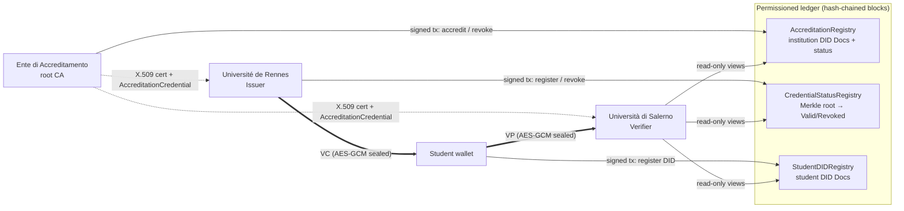
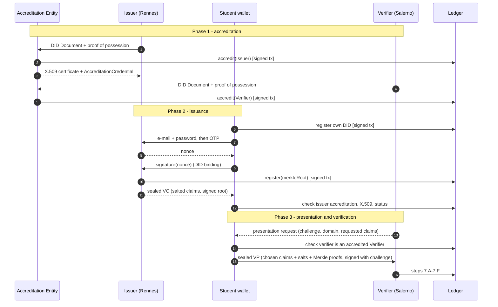
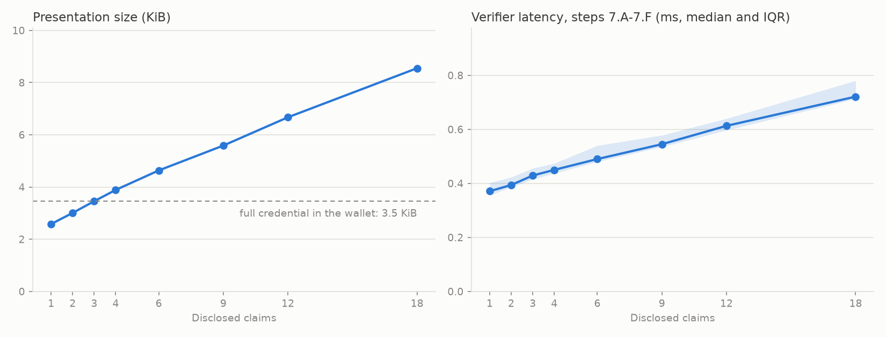

# Selective Sharing of Academic Credentials

[](https://github.com/SalvatoreFTartaglione/erasmus-credential-sharing/actions/workflows/ci.yml)


A decentralised, privacy-preserving system that lets an **Erasmus student** prove to their home university the exams passed abroad, **revealing only the information that is needed**. The receiving university verifies the proof **without contacting the issuing university**, and the issuer can **revoke** the credential at any time.

The project implements, end to end, a protocol built on **W3C Verifiable Credentials and DIDs**, **salted Merkle-tree selective disclosure**, an **X.509 accreditation PKI** and smart contracts on a **simulated permissioned ledger**. It comes with a threat model, a test-suite that reproduces each attack from the model, and benchmarks.

> Project work for *Algoritmi e Protocolli per la Sicurezza* (MSc Computer Engineering, University of Salerno, A.Y. 2024/25).
> The protocol follows a full design document (Italian) covering the threat model, security properties, protocol and security analysis; it is available on request.

---

## Contents

- [The scenario](#the-scenario)
- [Quick start](#quick-start)
- [Architecture](#architecture)
- [Protocol](#protocol)
- [Threat model and how each attack is stopped](#threat-model-and-how-each-attack-is-stopped)
- [Cryptographic design choices](#cryptographic-design-choices)
- [Performance](#performance)
- [Security review of the first version](#security-review-of-the-first-version)
- [Limitations and future work](#limitations-and-future-work)
- [Project structure](#project-structure)
- [Authors](#authors)

## The scenario

| Actor | Role |
|---|---|
| **Ente di Accreditamento (AE)** | Root of trust. It acts as X.509 root CA, accredits universities after checking that they control their keys, and is the only party allowed to write to the `AccreditationRegistry`. |
| **Université de Rennes** (Issuer) | Authenticates the student with a password and a one-time password, then issues a credential that lists every course in the learning agreement. It registers the credential's status on the ledger and can revoke it. |
| **Student** (Holder) | Keeps the credential in an encrypted wallet and builds presentations that disclose only the claims they choose. |
| **Università di Salerno** (Verifier) | Verifies a presentation offline, using only the ledger and the AE trust anchor. It processes nothing beyond the claims it requested. |

## Quick start

```bash
python -m venv .venv && source .venv/bin/activate   # Windows: .venv\Scripts\activate
pip install -r requirements-dev.txt

python main.py --demo      # full scenario + six simulated attacks (non-interactive)
python main.py             # interactive wallet
pytest                     # 84 tests, including the attack scenarios
python -m benchmarks.benchmark
```

Excerpt from `python main.py --demo --quiet`:

```text
Università di Salerno asks for 'Data Science' and 'Automation' only.
  [ OK ] TLS  Secure channel (AES-256-GCM): payload decrypted and authenticated
  [ OK ] 7.A  Holder signature and holder binding: signed by did:erasmus:b265…, who is the credential subject
  [ OK ] 7.B  Issuer signature and Merkle proofs: issuer signature valid, 2 claim(s) proven against the Merkle root
  [ OK ] 7.C  Issuer DID, role and accreditation: accredited Issuer, X.509 certificate chains to the AE root
  [ OK ] 7.D  Revocation status and validity period: credential is Valid on the ledger and not expired
  [ OK ] 7.E  Challenge-response (freshness and audience): signature covers a fresh, single-use challenge
  [ OK ] 7.F  Selective processing of requested claims: 2 claim(s) accepted
  => presentation ACCEPTED

Summary
  - Malicious student raises a grade and re-signs           rejected at 7.B: Merkle proof … does not match the signed root
  - Malicious student adds an exam never taken              rejected at 7.B: Merkle proof … does not match the signed root
  - Eavesdropper/verifier replays a captured presentation   rejected at 7.E: unknown or already used challenge
  - Impersonator presents a stolen credential               rejected at 7.A: the presenter is not the subject of the credential
  - Man in the middle tampers with the encrypted VP         rejected at TLS: message failed authentication
  - Presentation after the issuer revoked the credential    rejected at 7.D: credential status is Revoked
```

## Architecture



Every state-changing call to a contract is a **signed transaction**. A contract checks the signature, the sender's rights and a per-sender nonce before it changes state, in the same way an EVM contract checks `msg.sender`. Reads are free "view" calls. Consensus and networking are not modelled. See [Limitations](#limitations-and-future-work).

## Protocol

The phases and step numbers follow WP2 of the report.



**What the verifier checks** (`credential_sharing/actors/verifier.py`):

| Step | Check |
|---|---|
| TLS | The AES-256-GCM tag is valid, and the message is addressed to this verifier. |
| 7.A | The holder's signature verifies with the key in the holder's on-chain DID Document. The holder is the credential subject (holder binding). |
| 7.B | The issuer's signature covers the Merkle root **and** all credential metadata. Every disclosed claim has a valid Merkle proof. |
| 7.C | The issuer is registered **with the Issuer role** and its status is `Accredited`. Its X.509 certificate chains to the AE root, and its DID, role and key match the ledger. |
| 7.D | The ledger reports the credential as `Valid`, the status entry belongs to the same issuer, and the credential is inside its validity period. |
| 7.E | The signed challenge was issued by this verifier, has not expired and has not been used before. The `domain` is this verifier. |
| 7.F | Every requested claim is present. Claims that were not requested are dropped (data minimisation). |

## Threat model and how each attack is stopped

The adversaries are the ones defined in the report (WP1). Each attack is reproduced in `tests/test_presentation_attacks.py` and in `python main.py --demo`.

| Adversary | Attack | Defence | Rejected at |
|---|---|---|---|
| Malicious student | Edits a grade and re-signs the VP with their own key | The disclosed value no longer hashes to a leaf under the issuer-signed root | 7.B |
| Malicious student | Adds an exam that is not in the credential | No valid Merkle proof can exist for it | 7.B |
| Malicious student | Extends `expirationDate` or other metadata | The metadata is covered by the issuer signature | 7.B |
| Malicious verifier / eavesdropper | Replays a captured presentation | A single-use challenge with a TTL, covered by the holder signature | 7.E |
| Malicious verifier | Infers undisclosed grades from the Merkle proofs | Every leaf carries a 128-bit random salt | not feasible |
| Impersonator | Presents a stolen credential under their own DID | Holder binding: the presenter must be the credential subject | 7.A |
| Impersonator | Binds a victim's DID to their own account at the issuer | Proof of possession on an issuer nonce, and DIDs derived from public keys | issuance |
| Impersonator | Brute-forces the student's password or OTP | scrypt hashes, OTPs that are single-use and expire in 120 s, exponential back-off and lock-out | login |
| Man in the middle | Tampers with or re-routes the encrypted VP | AES-GCM with the sender and recipient DIDs as associated data | TLS |
| Rogue institution | Issues credentials without accreditation, or issues them as a Verifier | The role and status checks, plus the contract ACL on `register` | 7.C / ledger |
| Anyone | Takes over the accreditation authority or forges a ledger transaction | The authority is fixed at deployment, and transactions are signed and carry a nonce | ledger |
| Device thief | Reads keys or credentials from the wallet | The wallet is encrypted at rest with scrypt and AES-256-GCM | – |

## Cryptographic design choices

- **Selective disclosure with salted Merkle trees.** The `credentialSubject` is split into independent claims: one per personal attribute and one per course. Each leaf is `SHA-256(0x00 ‖ canonical_json({name, salt, value}))` with a fresh 128-bit salt. This is the same idea as SD-JWT, and it is what stops a verifier from brute-forcing hidden values out of the Merkle proofs.
- **A hardened Merkle tree.** Leaves and internal nodes are hashed with different prefixes (`0x00`/`0x01`, as in RFC 6962), so the tree resists second-preimage attacks. An unpaired node is promoted to the next level instead of being duplicated, which avoids the CVE-2012-2459 ambiguity.
- **One issuer signature over everything that matters.** RSA-PSS/SHA-256 signs the Merkle root, the credential id, the issuer, the dates, the status entry and the holder DID.
- **Self-certifying DIDs.** A DID has the form `did:erasmus:<SHA-256(SPKI)[:40]>`. Registries reject any document whose key does not match its DID, which prevents DID squatting.
- **X.509 PKI for accreditation.** The AE root certificate has `BasicConstraints(ca, path_length=0)`. Each end-entity certificate carries the DID in its CN and the role in its OU. Validation checks the chain, the validity window, the CA flag, the DID, the role and that the certificate key equals the DID-document key.
- **Channel.** The project models TLS by wrapping an AES-256-GCM key with RSA-OAEP under the recipient's key, which is taken from the ledger and validated through its certificate. The sender and recipient DIDs are authenticated data.
- **Canonical JSON.** Every hash and signature is computed over the same canonical encoding: sorted keys, no whitespace, UTF-8.

## Performance

Run with `python -m benchmarks.benchmark`. The results are in [`benchmarks/results/`](benchmarks/results). Sizes are bytes of canonical JSON.



| Disclosed claims | VP size (B) | Encrypted VP (B) | Build VP (ms) | Verify VP, median [IQR] (ms) |
|---:|---:|---:|---:|---:|
| 1 | 2,643 | 4,079 | 0.73 | 0.37 [0.36-0.40] |
| 2 | 3,080 | 4,661 | 0.76 | 0.39 [0.39-0.42] |
| 4 | 3,982 | 5,864 | 0.81 | 0.45 [0.44-0.47] |
| 9 | 5,722 | 8,184 | 0.91 | 0.55 [0.54-0.58] |
| 18 (all) | 8,756 | 12,229 | 1.06 | 0.72 [0.71-0.78] |

<sub>Python 3.11.9, Windows, AMD64, 50 runs. The full credential in the wallet is 3,547 B. Issuance, which covers login, DID binding, issuance and the wallet checks, takes about 50 ms.</sub>

A presentation costs about 2.2 KB of fixed overhead: two RSA-2048 signatures, the metadata and the status entry. Each disclosed claim then adds about 0.4–0.7 KB, depending mostly on its Merkle proof. Verification stays below 1 ms. The design goal of small, hardware-wallet-friendly presentations is what drives the items under [future work](#limitations-and-future-work).

## Security review of the first version

The first version of this repository was submitted as course work. Before publishing it, I reviewed it and wrote proof-of-concept exploits against it. They showed that a student could **raise their own grades**, **present somebody else's credential** and **replay presentations**, and that the verifier still accepted the result. Among other causes, Merkle proofs were never checked, holder binding was missing, the challenge-response always returned `True`, the leaves were unsalted, and the contracts had no access control.

Every finding was fixed in version 2, and every exploit is now a regression test (see `tests/test_presentation_attacks.py` and `tests/test_ledger_and_contracts.py`).

## Limitations and future work

- **Simulated infrastructure.** The ledger is a single hash-chained list with no consensus, and the "TLS" layer is a hybrid-encryption model rather than a TLS stack. OTP delivery and the institutional vetting done by the AE are also simulated.
- **Unlinkability (property C.5 in the report).** The holder DID, the issuer signature and the Merkle root are the same in every presentation, so two verifiers who collude can link them. The report's mitigation is BBS+ signatures, which give unlinkable zero-knowledge selective disclosure with constant-size proofs, combined with pairwise DIDs.
- **Size.** Possible reductions are Ed25519 instead of RSA-2048 (64-byte instead of 256-byte signatures), Merkle multiproofs that deduplicate shared siblings, and a binary encoding such as CBOR.
- **Operations not covered.** Key rotation, credential re-issuance and persistent storage are not implemented.

## Project structure

```text
credential_sharing/
├── actors/            # AccreditationEntity, Issuer, Verifier, Wallet, Student
├── crypto/            # RSA keys & signatures, Merkle tree, secure channel
├── dlt/               # Ledger + AccreditationRegistry, CredentialStatusRegistry, StudentDIDRegistry
├── identity/          # DIDs, DID resolution, X.509 certificates
├── credential.py      # claims, salted leaves, signing inputs
├── verification.py    # checks shared by wallet and verifier
├── auth.py            # scrypt passwords, OTP, throttling
├── adversary.py       # attacks from the threat model (used by demo and tests)
├── scenario.py        # wiring of the whole system
└── cli.py             # interactive wallet and --demo
tests/                 # 84 tests: primitives, contracts, issuance, attacks, CLI
benchmarks/            # size/latency benchmark + results
```

## Authors

- **Salvatore Francesco Tartaglione**
- **Christian Rosa**

The project was designed and first implemented together as a two-person project work. Version 2 (the security review, the hardening, the tests, the benchmarks and the documentation) was carried out by Salvatore Francesco Tartaglione.
